# RoboticArm V1 & V2 (2015)

### A 3D-printable, Arduino-controlled, six-axis robotic arm with manual control, teaching and automatic replay

**Designed and built by Juergen Lessner · 2015**

[](https://youtu.be/9O9il31Ai6k)

*Original 2015 demonstration: RoboticArm V2 lifting a 285 g load. Click the image to watch the video.*

This repository documents the development of my **RoboticArm**, from the first working prototype (**V1**) to the substantially revised **V2** with an LCD-equipped control panel, MicroSD storage, a **teaching mode**, and **automatic replay**.

Both versions use **six controlled axes and seven hobby servos**: the shoulder axis is driven by two servos together. The controller is an **Arduino Mega 2560** with a **PCA9685 16-channel PWM servo driver**. The mechanical parts were designed for desktop 3D printing.

The work took approximately **250 hours in total** for the first prototype and the completed V2. These are the original designs and software from **2015**. They are preserved as a historical maker project; this documentation was expanded later to make the construction, operation, and development history easier to understand.

> **Important before assembly:** **Do not install the servos into the mechanical arm first.** Number and connect all seven servos while they are still outside the arm, upload and start the original Arduino firmware, and let the firmware move the servos to their defined start positions. Only then install them in the **upright (vertical) home position**, without turning their output shafts. Incorrect mechanical alignment can cause a servo to reach its physical rotation limit, stall, or shut down. See [Servo initialization and mechanical alignment](#servo-initialization-and-mechanical-alignment--read-before-assembly).

## Contents

- [The two development stages](#the-two-development-stages)
- [RoboticArm V1 — the prototype](#roboticarm-v1--the-prototype)
- [RoboticArm V2 — the finished design](#roboticarm-v2--the-finished-design)
- [Technical specifications](#technical-specifications)
- [Parts and materials](#parts-and-materials)
- [3D printing](#3d-printing)
- [Original voltage-regulator schematic](#original-2015-voltage-regulator-schematic)
- [Servo initialization and mechanical alignment](#servo-initialization-and-mechanical-alignment--read-before-assembly)
- [Assembly overview](#assembly-overview)
- [Electronics and wiring](#electronics-and-wiring)
- [Arduino software](#arduino-software)
- [Operating modes and controls](#operating-modes-and-controls)
- [MicroSD teaching and replay files](#microsd-teaching-and-replay-files)
- [Original demonstration videos](#original-demonstration-videos)
- [Original files, drawings and photographs](#original-files-drawings-and-photographs)
- [Historical notes and limitations](#historical-notes-and-limitations)
- [Credits and links](#credits-and-links)

---

## The two development stages

| Feature | V1 — prototype | V2 — revised design |
| --- | --- | --- |
| Project period | 2015 | 2015 |
| Controlled axes | 6 | 6 |
| Physical servos | 7, including two on the shoulder | 7, including two on the shoulder |
| Control electronics | Arduino Mega + PCA9685 | Arduino Mega + PCA9685 |
| Control | Manual push-button control; teaching features considered during development | Manual control, position teaching and automatic replay |
| Mechanical design | First working 3D-printed construction; early arm and base geometry | Revised geometry, smaller base enclosure, improved components, and parts separated for easier printing and assembly |
| Gripper | The early construction notes describe an aluminium gripper | 3D-printable V2 mechanical design |
| Display and storage | Original control design with a 20 × 4 LCD | Revised 16 × 2 I²C LCD and MicroSD card reader |
| Software | Original prototype and servo test work | Original V2 firmware with Normal / Programming / Replay modes |

### Why I built a 3D printer first

When I started planning the robotic arm, I considered plywood, aluminium and fibre-reinforced materials. However, accurately manufacturing custom mechanical parts without a CNC machine would have been difficult. Rather than abandon the project, I built my own **RepRap-style 3D printer**. After several months, I could finally print the arm components I had designed.

Cost was another important design constraint. I chose relatively affordable, metal-geared RC servos instead of more expensive motor and gearbox assemblies, while trying to obtain sufficient torque to lift the arm and a useful payload.

## RoboticArm V1 — the prototype

The following photographs and drawings are original material from the first prototype, preserved under [`archive/V1/`](archive/V1/).

| Original V1 front photograph | Additional V1 photograph |
| --- | --- |
| 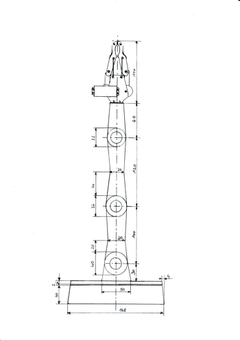 |  |

V1 established the essential mechanical and electrical architecture:

- A **six-axis articulated arm**, using **seven servos** because the shoulder joint is driven by a pair.
- An **Arduino Mega 2560** and **PCA9685 PWM driver** to control servo positions.
- A **rotating base supported by ball bearings**, reducing the weight and tilting load carried by the base servo.
- A manually operated **push-button control panel**.
- Custom mechanical parts designed in CAD and produced on the newly built 3D printer.
- An early **aluminium gripper** in the prototype construction.

The development notes record an overall arm length of approximately **468 mm**, with about **390 mm from the first arm pivot to the gripper tip** in the revised prototype drawings. An early calculation estimated approximately **294 g of payload** at full extension, based on assumed servo torque and arm weight; this is a **theoretical historical estimate**, not a measured V1 lifting test.

### V1 servo choices

The original prototype notes list:

| Quantity | Servo | Notes from the 2015 development record |
| ---: | --- | --- |
| 1 | Turnigy TGY1501 Hi-Torque | Metal gears; approximately 15.5–17 kg·cm specified torque, depending on voltage |
| 6 | TowerPro MG995 | Metal gears; approximately 10–15 kg·cm specified torque, depending on voltage |

The first prototype was an important testbed for the bearing-supported base, load-bearing arm geometry, servo positioning, electronics and manual controls.

### V1 construction sketches and photographs

These photographs and sketches document the original V1 development. The files are retained under their historical names.

| Development sketches | Base construction |
| --- | --- |
| 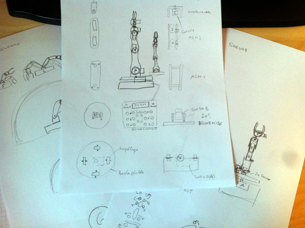 | 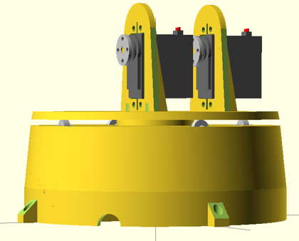 |

**Other original V1 material:** [additional sketches](archive/V1/skizzen1.jpg), [arm image 1](archive/V1/arm1.jpg), [arm image 9](archive/V1/arm9.jpg), [second arm photograph](archive/V1/roboterarm2.jpg), [bottom view](archive/V1/robotarm_bottom.jpg), and [base cut view](archive/V1/robotbase_cut.jpg).

The V1 hand-drawn electrical diagrams are linked in [Original wiring diagrams](#original-wiring-diagrams) below.

## RoboticArm V2 — the finished design

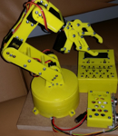

*Original V2 photograph, preserved in the project archive.*

V2 was designed to make the arm easier to build, more reliable mechanically, and substantially more capable in operation. The following details come from the original **“Release Infos RA2”** comparison between Versions 1 and 2.

### Changes from V1 to V2 — mechanics

- Reduced the diameter of the base cylinder to shorten printing time and reduce material consumption.
- Installed the servo controller inside the base cylinder.
- Added recesses for M3 nuts to the base-servo mounting block.
- Split the base plate into sections so that the servos are easier to mount.
- Enlarged the cable opening in the base plate.
- Made the arm parts compatible with lower-cost plastic servo mounting horns/adapters.
- Reinforced the rear section of the upper arm.
- Improved the fit of the servo recesses in the upper arm.
- Recessed the M3 nuts into the material near the front rotation area.
- Improved the fit of the upper-arm bearing support.
- Reinforced the wrist and recessed its servo-mounting nuts into the printed parts.
- Redesigned the **gripper so that it can be printed completely**, unlike the earlier construction with an aluminium gripper.
- Improved cable routing throughout the entire arm.

**Original V2 gripper photographs:**

| V2 gripper image 1 | V2 gripper image 2 |
| --- | --- |
| 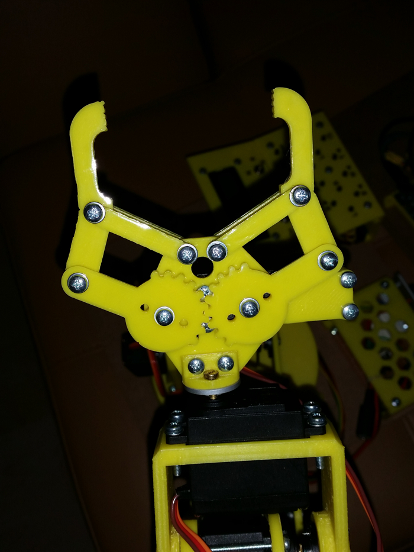 | 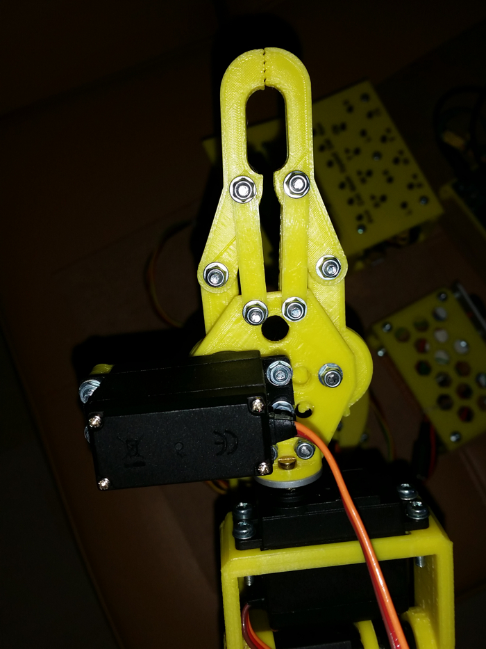 |

### Changes from V1 to V2 — electronics

- Enclosed the complete control electronics in a housing.
- Expanded the control keyboard by **six push buttons and two switches**.
- Replaced the earlier **20 × 4 LCD** with a more compact **16 × 2 I²C LCD**.
- Added a **MicroSD card reader** to record and replay arm movements.
- Replaced soldered interconnection wiring with **crimped plug connectors**.
- Included the original **5 A adjustable servo-voltage regulator**, allowing a readily available **12 V / 5 A DC power supply** to be used. The historical circuit provides approximately 5.8–6 V or 7.2 V, depending on its resistor configuration; see the [original recovered schematic](#original-2015-voltage-regulator-schematic).

**Original V2 control-panel photographs:**

| Control-panel photograph | Internal keyboard construction |
| --- | --- |
| 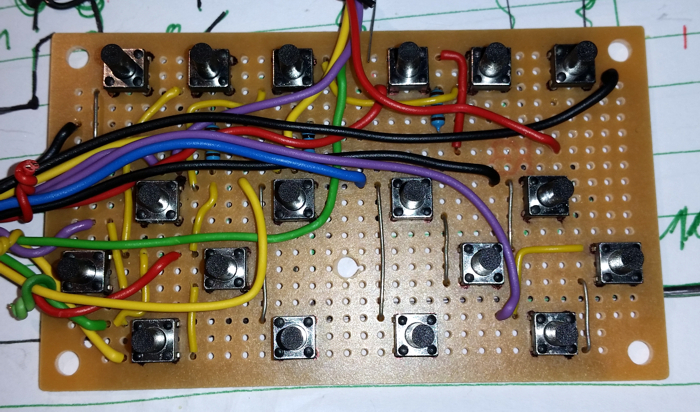 | 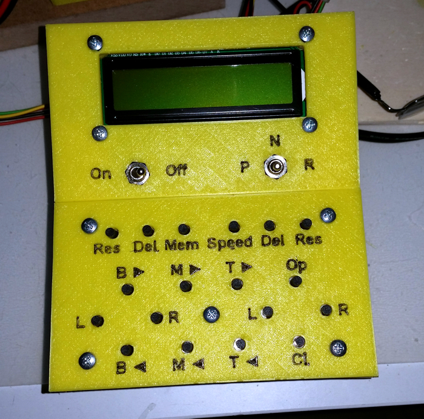 |

Further photographs: [keyboard image 5](archive/V2/RA2_Keyboard5.jpg) and [additional keyboard photograph](archive/V2/roboticarm_V2_keyboard.jpg).

### Changes from V1 to V2 — software and operation

- **Normal mode:** direct control of all six axes via the keyboard.
- **Programming / Teaching mode:** manually select positions and press **MEM** to save each position to the MicroSD card.
- **Protected deletion:** in the original control panel, press **both DEL buttons simultaneously** to request deletion of the saved `MEM.TXT` sequence; confirm with **MEM**, or cancel with the reset control.
- **Replay mode:** repeat saved positions endlessly. If `MEM.TXT` is absent, play the predefined `REP.TXT` sequence instead.
- **Protected reset:** the original panel requires pressing **both RST buttons simultaneously** to reset the Arduino and return to the power-on state.
- Improved the response of the **Speed** button.
- An early plan to use an **Arduino Nano** was abandoned due to insufficient program memory; **V2 retained the Arduino Mega** used for V1.

The original V2 demonstration shows the robot lifting **285 g**. This is a demonstrated result of that particular build, not a guarantee for every servo, print, power supply or arm configuration.

## Technical specifications

| Item | RoboticArm V2 |
| --- | --- |
| Year | 2015 |
| Controller | Arduino Mega 2560 / ATmega2560 |
| Servo driver | PCA9685, 16-channel, 12-bit PWM, connected over I²C |
| Servo signal frequency | 50 Hz in the original firmware |
| Controlled axes | 6 |
| Physical servo motors | 7 |
| Original suggested servos | TowerPro MG995; MG996R or suitably compatible alternatives may be considered |
| Shoulder joint | 2 servos using the same PWM channel |
| Display | 1602 (16 × 2) LCD with I²C adapter |
| Storage | MicroSD card, FAT32, using SPI |
| Recorded positions | Six three-digit PWM-count positions plus one speed flag per record |
| Operating modes | Normal, Programming (Teaching), Replay |
| Control panel | 3 × 6 button matrix, plus control buttons and switches |
| Original supply arrangement | 12 V / 5 A DC input; original LM338 / 2N2955 transistor-assisted 5 A regulator for approximately 5.8–7.2 V servo supply; separate 5 V logic |
| Mechanical fasteners | Mainly M3 hardware |
| Bearings | 8 × 623ZZ listed in the original V2 bill of materials |
| Demonstrated lifting | 285 g, as shown in the original video |

> Servo position numbers in this documentation refer to **PCA9685 PWM counts** in the original firmware, **not degrees**. Mechanical servo limits and directions depend on the actual servos and their mounting orientation.

## Parts and materials

The following is the **historical V2 bill of materials**, rearranged into functional groups for readability. It is a description of the 2015 build, not a claim that every substitute component has been tested with the original design.

### Mechanical parts

| Quantity | Component |
| ---: | --- |
| 1 set | 3D-printed RoboticArm V2 parts (see Thingiverse and the OpenSCAD source) |
| 7 | TowerPro MG995 servos or mechanically/electrically compatible alternatives |
| 8 | 623ZZ ball bearings |
| As required | M3 screws, approximately 10–40 mm lengths |
| As required | M3 nuts, including self-locking nuts, and M3 washers |
| As required | M3 plastic screws and nuts, and approximately 3 × 20 mm wood/self-tapping screws |
| Approx. 1 m | M3 threaded rod |
| As required | Cable ties and mounting materials |

### Control electronics

| Quantity | Component |
| ---: | --- |
| 1 | Arduino Mega 2560 |
| 1 | PCA9685 PWM servo driver |
| 1 | 16 × 2 LCD with I²C interface |
| 1 | MicroSD card reader compatible with the Arduino Mega's 5 V logic levels |
| 18 | Miniature momentary switches, 6 × 6 × 10 mm, 2.54 mm grid |
| 1 | ON/ON switch |
| 1 | ON/OFF/ON switch |
| 1 | Prototype board, approximately 94 × 53 mm, 2.54 mm grid |
| 3 | 10 kΩ, ¼ W resistors for the additional inputs |
| As required | Dupont crimp contacts, 1-/2-/3-/4-way housings, and several metres of coloured approximately 0.5 mm² stranded hookup wire |

### Original voltage-regulator parts

These components are listed in the historical 2015 bill of materials and are now also documented by the **recovered original schematic**:

| Quantity | Component |
| ---: | --- |
| 3 | 2N2955 / MJ2955-type PNP power transistors, as identified in the historical documentation, with heat sinks |
| 1 | LM338 adjustable voltage regulator with heat sink |
| 3 | 0.1 Ω, 5 W resistors |
| 1 | 6 Ω, 2 W resistor |
| 1 | 270 Ω, ¼ W resistor |
| 1 | 1.3 kΩ, ¼ W resistor |
| 2 | 100 nF ceramic capacitors |
| 1 | 1 µF, 16 V electrolytic capacitor |
| 1 | Prototype board, approximately 50 × 70 mm, 2.54 mm grid |
| As required | Insulated hookup wire and heat-sink mounting hardware |

### Original 2015 voltage-regulator schematic

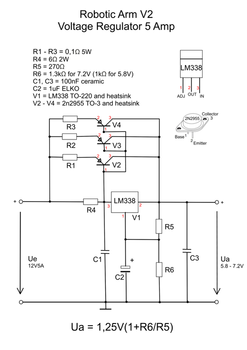

*Original RoboticArm V2 **5 Amp** voltage-regulator circuit drawing, recovered from the project archive. The image is preserved without modification. It was designed with the help of Alfred (see Credits).*

The original archived drawing is also available as [`archive/drawings/roboticarm_V2_voltageregulation.jpg`](archive/drawings/roboticarm_V2_voltageregulation.jpg), alongside a [photograph of the V2 regulator assembly](archive/V2/PA2_voltageregulator.jpg). Both archival images retain their original filenames.

The drawing documents:

| Designator | Original marking | Function / note |
| --- | --- | --- |
| V1 | LM338 (TO-220) | Adjustable linear regulator with heat sink |
| V2–V4 | 2N2955 (TO-3) | Three external PNP power transistors, each with a heat sink |
| R1–R3 | 0.1 Ω, 5 W each | Resistors in the three external transistor paths |
| R4 | 6 Ω, 2 W | Part of the original regulator circuit |
| R5 | 270 Ω | Reference resistor in the output-adjustment network |
| R6 | 1.3 kΩ for 7.2 V / 1 kΩ for 5.8 V | Historical alternative output-voltage settings |
| C1 and C3 | 100 nF ceramic | Capacitors shown at input and output |
| C2 | 1 µF electrolytic | Electrolytic capacitor in the adjustment circuit |
| Input | 12 V DC / 5 A | Original specified external supply |
| Output | Approx. 5.8–7.2 V DC | Original intended regulated servo supply, rated at 5 A in the drawing |

The original drawing gives this nominal adjustment equation:

`Uout = 1.25 V × (1 + R6 / R5)`

For the two historical R6 choices, this ideal formula produces about **7.27 V** (1.3 kΩ) or **5.88 V** (1 kΩ). These are **calculated setpoints, not verified performance measurements** of the assembled circuit.

> **Electrical safety / historical reproduction:** This is the recovered original 2015 drawing, **not a modern, independently verified or certified power-supply design**. It contains a high-current linear regulator and external pass transistors; thermal dissipation, transistor pinouts and genuine component variants, protection, wiring gauge and short-circuit behaviour must all be assessed before reconstruction. A modern, adequately protected DC regulator may be a safer choice for a new build. The drawing starts at a **12 V DC input**; it is not a mains-wiring instruction. Do not power seven high-current servos from the Arduino 5 V output, USB port or logic rail.

## 3D printing

These are the settings I documented for the original V2 build:

| Setting | Original value |
| --- | --- |
| Printer type | RepRap, i3 Prusa Rework |
| Filament | ABS, 1.75 mm |
| Nozzle diameter | 0.3 or 0.4 mm |
| Layer height | 0.2–0.3 mm |
| Infill | 20% |
| Print speed | Approximately 80–120 mm/s |
| Raft | No |
| Supports | Only where needed |

The original printed design uses **M3 bolts and nuts**. Actual tolerances can differ between printers and materials; check holes, servo pockets, shafts and bearing fits before fastening everything. The original design had to fit a printer with a maximum printable part length of approximately **200 mm**.

**Design source:** [`RoboticArm_V2_1.1.scad`](RoboticArm_V2_1.1.scad)  
**Original V2 STL files in this repository:** [`archive/V2-STL/STL_V2.1.1.zip`](archive/V2-STL/STL_V2.1.1.zip)  
**Original external publication:** [Thingiverse — Roboticarm V2, thing 969460](https://www.thingiverse.com/thing:969460)

The STL archive can be downloaded directly from GitHub. The ZIP file itself is an original historical release; it has not been unpacked or modified for this README update.

The SCAD file is an original source file. Do not overwrite or silently modernize it when documenting the project.

## Servo initialization and mechanical alignment — READ BEFORE ASSEMBLY

> [!CAUTION]
> **This is essential. Initialize the servos *before* fitting them to the arm.** The original servos do not rotate freely through 360°. Installing them in an arbitrary shaft position can cause the firmware to command motion beyond a servo's available rotation. The servo may stall, overload, or shut down, and the mechanism can be damaged.

Follow this order:

1. **Keep all seven servos outside the mechanical assembly.** Do not connect their output shafts to the arm links yet.
2. **Label every physical servo** according to its mechanical position and its PWM connection. There are six control channels, but **two separate servos share shoulder channel 1**.
3. Connect the servo driver to the Arduino, and connect **all seven servo signal connectors** correctly. Confirm supply polarity, signal routing, and the servo power supply. The PCA9685 control board needs a logic supply and a suitable separate servo supply.
4. **Upload the original [`roboticarmV2.ino`](roboticarmV2.ino) firmware** to the Arduino Mega 2560. Make sure the required libraries are available.
5. With the servos **unloaded and clear of obstructions**, power the controller and servo supply. Start or reset the Arduino. During `setup()`, the firmware commands the PWM channels to their initial positions.
6. Allow every servo to reach and settle at its commanded position. **Do not twist the output shafts by hand** after positioning them. Take care that neither the servo bodies nor their horns can strike anything during startup.
7. Assemble the links so that the **arm is upright / vertical in its home position**. Fit each servo horn or coupling to the stationary, initialized servo shaft in the correct mechanical orientation. If the indexed horn angle is not suitable, reposition the **detached horn**; do not force the servo shaft past its powered position.
8. Make sure the two shoulder servos are mechanically aligned with one another. Both receive the same PWM command and must not fight each other when the shoulder link is connected.
9. Support the arm, keep it unloaded, and test **small movements** in each direction first. Check for binding and physical end stops before trying full travel or a heavy load.
10. If a joint moves in the wrong direction, hits a stop, or stalls, **remove power immediately**. Correct the mechanical orientation and restart the alignment procedure. Do not try to overcome the problem with more voltage or by forcing the joint.

### Start positions commanded by the original V2 firmware

The following values are taken from the actual `pwm.setPWM()` calls in the published `setup()` routine, in the order in which they are sent:

| PWM channel | Mechanical function | Startup PWM count |
| ---: | --- | ---: |
| 1 | Shoulder (**two servos together**) | 277 |
| 2 | Elbow | 292 |
| 3 | Wrist bend | 277 |
| 4 | Wrist rotation | 105 |
| 5 | Gripper open/close | 300 |
| 0 | Base rotation (**initialized last**) | 470 |

These counts are not interchangeable with the shaft's physical installation angle. **The correct mechanical home posture is the upright arm, using the specific servo horn orientation established during assembly.** The original software uses some slightly different internal default variables for channels 1 and 3; the table deliberately lists the **actual PWM commands sent at startup**, which are the values that matter for initial mechanical fitting.

## Assembly overview

This describes the intended construction sequence rather than replacing the original STL geometry or the historical photographs.

1. **Print and inspect the mechanical parts.** Clean up support material only where necessary. Verify bearing seats and fastener locations.
2. **Prepare the base and bearings.** Build the rotating bearing-supported platform. The original concept distributes the arm's load across bearings so the base servo is not required to support the arm's weight directly.
3. **Prepare the control and power electronics.** Assemble the keyboard and mount the Arduino, LCD, MicroSD reader, and PCA9685. Inspect the 5 V logic supply and the independent regulated servo supply.
4. **Number, connect, initialize and align all servos while unmounted.** Follow the [mandatory calibration procedure above](#servo-initialization-and-mechanical-alignment--read-before-assembly).
5. **Fit the servos and links in the vertical home position.** Begin with the base, then install the two aligned shoulder servos, upper arm, elbow, wrist and gripper. Preserve the shaft orientations established at initialization.
6. **Route and secure cables.** Leave enough slack for each permitted joint movement; avoid wires crossing moving pivots or being pinched by the printed parts.
7. **Perform an unloaded motion check.** Test one axis at a time and verify that no joint reaches a mechanical limit before the software's allowed range.
8. **Test the operating modes.** Check manual movement, display, MicroSD storage, teaching and replay before attempting the demonstrated load.

## Electronics and wiring

The pin assignments in this section were checked against the **original V2 Arduino source**, not merely copied from a secondary project description.

### PCA9685 servo driver → Arduino Mega 2560

| PCA9685 signal | Arduino Mega |
| --- | --- |
| VCC (logic) | +5 V |
| GND | GND |
| SDA | D20 / SDA |
| SCL | D21 / SCL |

The **servo power terminals** of the PCA9685 must be supplied at the voltage and current required by the connected servos, independently of the logic supply. Grounds must share a suitable common reference. Verify the exact terminals of your PCA9685 breakout board; do not mistake its logic VCC for the high-current servo supply.

### PCA9685 PWM outputs → mechanical axes

| PCA9685 output | Axis | Servos |
| ---: | --- | ---: |
| 0 | Base rotation | 1 |
| 1 | Shoulder | **2** |
| 2 | Elbow | 1 |
| 3 | Wrist bend | 1 |
| 4 | Wrist rotation | 1 |
| 5 | Gripper open / close | 1 |
| **Total** | **6 controlled axes** | **7 servos** |

For the two shoulder servos, use a suitable signal distribution connection for output 1 and provide adequate power wiring for both motors.

### Control keyboard → Arduino Mega 2560

The original code scans a **3-row × 6-column keyboard matrix**:

| Keyboard connector | Connection |
| ---: | --- |
| 1 | D30 — row 1 |
| 2 | D32 — row 2 |
| 3 | D34 — row 3 |
| 4 | D31 — column 1 |
| 5 | D33 — column 2 |
| 6 | D35 — column 3 |
| 7 | D37 — column 4 |
| 8 | D39 — column 5 |
| 9 | D41 — column 6 |
| 10 | +5 V |
| 11 | D19 / RX1; 10 kΩ resistor to GND |
| 12 | D36; 10 kΩ resistor to GND |
| 13 | D38; 10 kΩ resistor to GND |
| 14 | Arduino RESET |
| 15 | GND |

The mode and speed switches use the additional inputs. The **code is authoritative for their functionality**:

| Arduino pin | Function in the executable source |
| --- | --- |
| D19 | Speed input / interrupt 4 |
| **D38** | **Programming / Teaching mode** (`progPin = 38`) |
| **D36** | **Replay mode** (`replPin = 36`) |
| RESET | Arduino reset |

**Historical discrepancy:** The comment block at the top of the original `.ino` file (and the older Thingiverse text) labels D36 as programming and D38 as replay. The program itself defines **D38 as programming** and **D36 as replay**. Follow the executable variable declarations when wiring and troubleshooting the mode switch.

### 16 × 2 I²C LCD → Arduino Mega 2560

| LCD module | Arduino Mega |
| --- | --- |
| VCC | +5 V |
| GND | GND |
| SDA | D20 / SDA |
| SCL | D21 / SCL |

The original code uses the LCD I²C address **`0x27`**. Other display modules may use a different address and require an adjustment or a compatible library version.

### MicroSD card reader → Arduino Mega 2560

| SD reader | Arduino Mega |
| --- | --- |
| GND | GND |
| VCC | +5 V **only if the reader module is designed for 5 V** |
| MISO | D50 |
| MOSI | D51 |
| SCK | D52 |
| CS | D53 |

Use an appropriate SD breakout with a regulator and logic-level compatibility for a 5 V Arduino Mega. A bare 3.3 V SD card must not be wired directly to 5 V signals.

### Original wiring diagrams

The following historical electrical drawings have been added to the repository **without changing their original image files**.

**RoboticArm V1 — original wiring and keyboard circuit:**

| V1 wiring diagram | V1 keyboard circuit layout |
| --- | --- |
| 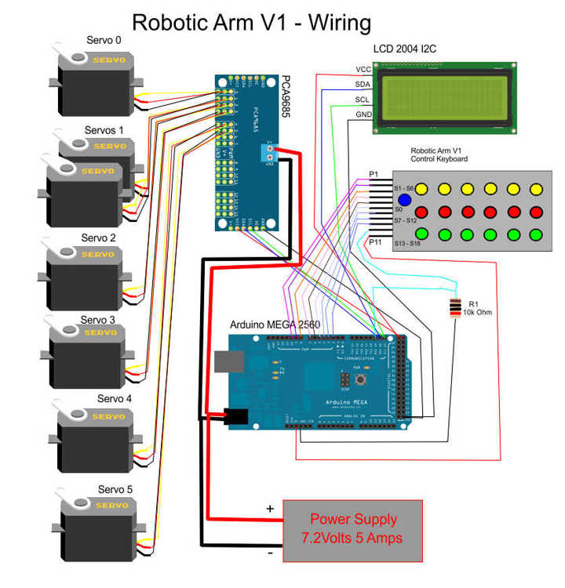 | 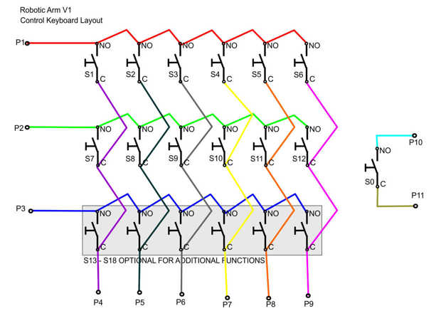 |

**RoboticArm V2 — original keyboard wiring drawing:**

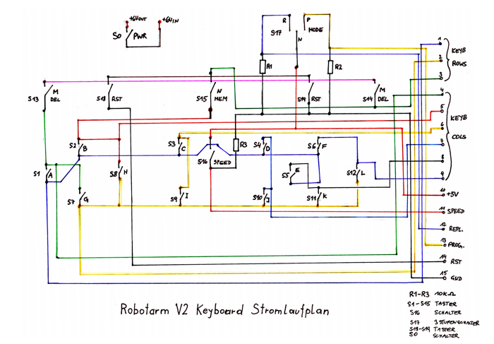

The original V2 [voltage-regulator drawing](archive/drawings/roboticarm_V2_voltageregulation.jpg) is also archived. A readable version of the [5 A voltage-regulator schematic](#original-2015-voltage-regulator-schematic) is reproduced above. These are historical circuit records, not a substitute for appropriate electrical validation when building hardware today.

## Arduino software

**Original source:** [`roboticarmV2.ino`](roboticarmV2.ino)

The repository's original V2 sketch identifies itself as:

```text
RoboarmControlV2 - Program V1.1
2015_08_30 copyright 2015 by Juergen Lessner
for Arduino MEGA
```

An earlier Thingiverse description referred to `RoboarmControl V2 – V1.0` dated 2015-08-03. **The GitHub source linked above is the later V1.1 file dated 2015-08-30.** Both references are part of the development history.

### Libraries used by the original sketch

- `Wire.h` — Arduino I²C interface
- `Adafruit_PWMServoDriver.h` — PCA9685 PWM driver
- `Keypad.h` — keyboard matrix scanning
- `LiquidCrystal_I2C.h` — I²C LCD
- `SPI.h` — SPI bus
- `SD.h` — MicroSD file operations

The libraries were used in **2015**; their contemporary versions and APIs may differ. This archive is not a claim of compatibility with a modern Arduino IDE/library combination without testing. Preserve the original source. If future compatibility changes are required, publish them as a **separate, clearly identified version**, not an overwrite of the historical sketch.

### Upload and first power-on

1. Install Arduino IDE and select **Arduino Mega or Mega 2560** as the board.
2. Install compatible versions of the libraries listed above.
3. Open [`roboticarmV2.ino`](roboticarmV2.ino), compile, and upload it to the Arduino Mega 2560.
4. Connect the correctly wired PCA9685 and the **unmounted, numbered servos**.
5. Power the controller and the servo supply. The firmware initializes the servo outputs and then initializes the SD reader.
6. Check the LCD and the power supply before assembly; follow the [servo alignment procedure](#servo-initialization-and-mechanical-alignment--read-before-assembly).

**Operating mode is read during `setup()` in the original sketch.** Select the desired mode **before starting or resetting** the Arduino. Do not assume a mode-switch change will take effect immediately without resetting the controller.

## Operating modes and controls

### 1. Normal mode

In Normal mode, the arm is controlled directly from the push-button keyboard. The six controlled axes can move in either direction, with the firmware enforcing position limits. The speed button toggles the manual movement speed setting.

In the original `Keypad` matrix, button letters correspond to the following control pairs:

| Axis | First direction | Opposite direction |
| --- | --- | --- |
| Base rotation (0) | A | H |
| Shoulder (1) | B | G |
| Elbow (2) | C | I |
| Wrist bend (3) | D | J |
| Wrist rotation (4) | E | L |
| Gripper (5) | F | K |

The letters are the **logical keys in the firmware**, not necessarily the labels printed on a particular physical control-panel housing. The buttons are scanned continuously, and movement occurs while a button is held.

### 2. Programming / Teaching mode

In Teaching mode the movement buttons still work, but the arm can also **memorize positions**:

1. Select Programming / Teaching mode and reset or power on the controller.
2. Use the movement buttons to position the arm.
3. Press **MEM** to append the current six-axis position to `MEM.TXT` on the MicroSD card.
4. Continue moving the arm and pressing **MEM** for each additional point in the sequence.
5. Switch to Replay mode and reset the Arduino when ready to play the recorded sequence.

**Deleting a recorded sequence (original V2 panel):** In Teaching mode, press **both physical DEL buttons together**. The keyboard electronics present the logical **`M`** action used by the firmware to display the deletion confirmation. The LCD then asks for **MEM** to confirm; pressing **both RST buttons together** resets the Arduino and cancels. Confirmation deletes `MEM.TXT` from the card. The firmware maps logical **`N`** to the MEM/save action.

**Reset:** The hardware reset on the original control panel is intentionally assigned to **two RST buttons pressed together**. As this is wired to Arduino RESET, restarting causes the startup positions and the operating mode to be read again. The original sketch also requires a valid SD card to finish its mode initialization.

### 3. Replay mode

In Replay mode the controller reads the saved sequence and moves the arm through its recorded positions, repeating the sequence continuously:

1. If **`MEM.TXT` exists**, it is used for replay.
2. Otherwise, the controller tries the default **`REP.TXT`**.
3. If neither file exists, the LCD reports that a record file is missing.

As written in the historical firmware, the replay sequence continues in a loop until operation is changed or power is removed. Keep the working area clear of people, loose cables, and obstructions during automatic motion.

## MicroSD teaching and replay files

The original design stores motion instructions as **plain-text files** on a **FAT32 MicroSD card**.

| File | Purpose |
| --- | --- |
| `MEM.TXT` | Recorded positions saved by pressing MEM in Teaching mode |
| `REP.TXT` | Default replay sequence, used if `MEM.TXT` does not exist |

### Record format

Each motion record uses **19 numeric characters**:

```text
S000111222333444555
│└──┘└──┘└──┘└──┘└──┘└──┘
│  0   1   2   3   4   5    <- servo channel
└─ speed flag (0 = fast, 1 = slow)
```

The single speed character is followed by **six fixed-width, three-digit PCA9685 position values**, in PWM-channel order 0 through 5. For example:

```text
0470275292270115300
```

This decodes to:

| Field | Value |
| --- | ---: |
| Speed | 0 (fast) |
| Channel 0 — base | 470 |
| Channel 1 — shoulder | 275 |
| Channel 2 — elbow | 292 |
| Channel 3 — wrist bend | 270 |
| Channel 4 — wrist rotation | 115 |
| Channel 5 — gripper | 300 |

**Format details:**

- All six positions must be written as **exactly three digits**. Preserve any leading zeros.
- Keep the records as plain ASCII numeric text, with **CRLF** (`\r\n`) line endings between records, as expected by the historical byte-by-byte parser.
- The original Thingiverse instructions specify **no CRLF after the final record** in a manually prepared `REP.TXT` file.
- The original firmware itself uses Arduino `println()` when writing `MEM.TXT`, so the automatically generated file may include a final line ending. This is a historical distinction between the published file-format instructions and the writer implementation.
- The firmware reads fixed-width fields and is not a general-purpose CSV or text-file parser. Do not add spaces, headings, commas or comments to the file.

### Original `REP.TXT` example

This sequence was published in the original 2015 Thingiverse description. To use it as the default program, copy **only the numeric lines** into a file named `REP.TXT`, use CRLF between records, and do not append an extra blank line. Verify the chosen servo limits and the mechanical assembly before replay.

```text
0470275292270115300
0470275472378115180
0470350449423115180
0470375449423115180
1470430449423115180
1470430449423115300
0470360449369455300
1470397449369455300
0470397449369455180
0470341449423115180
1470423449423115180
1470423449423115300
1470260305423115300
0470260305279115300
0115260305279115300
0115260305279115300
1115241385351115300
1115425385351115300
1115425385351115180
0115425385423115180
0115425385423455180
1115425329423455180
0115425329263455180
1115425329263455300
1115320289275455300
0115277289275455300
1115277289275115300
1115277129203115300
1115177129203115300
0115177129203115180
1115177129203115180
0115275129203115180
1115275250203115180
0115275292203115180
0115275292270115300
0470275292270115300
```

This is an original demonstration program, **not a recommended or safe universal motion program** for an independently assembled arm. Your servo brands, mounting orientation, physical clearances and control limits must match the intended construction.

## Original demonstration videos

These six videos were published with RoboticArm V2 in 2015 and show the actual historical project.

| Demonstration | Video |
| --- | --- |
| **Lifting 285 grams** — demonstrated payload | [Watch on YouTube](https://youtu.be/9O9il31Ai6k) |
| **Default replay program** — automatic pre-recorded sequence | [Watch on YouTube](https://youtu.be/V6Uo8PFwzVU) |
| **Normal mode** — manual operation | [Watch on YouTube](https://youtu.be/AB2lJiylMbM) |
| **Programming / Teaching mode** — storing positions | [Watch on YouTube](https://youtu.be/GGHi06hX_8k) |
| **Replay mode** — playing the stored movement sequence | [Watch on YouTube](https://youtu.be/hQDNdCDE1yY) |
| **The very first run** — first operation of the arm | [Watch on YouTube](https://youtu.be/6RR9RfMoR78) |

[](https://youtu.be/6RR9RfMoR78)

*The very first run — click to watch the original video.*

## Original files, drawings and photographs

This repository preserves the 2015 Arduino and OpenSCAD sources **unchanged**, and now also includes the historical photographs, electrical diagrams and a ZIP archive of the original V2 STL print files.

### Original source files

| File | Description |
| --- | --- |
| [`RoboticArm_V2_1.1.scad`](RoboticArm_V2_1.1.scad) | Original 2015 OpenSCAD source for V2 |
| [`roboticarmV2.ino`](roboticarmV2.ino) | Original Arduino Mega firmware, RoboarmControlV2 V1.1 (2015-08-30) |
| [`archive/V2-STL/STL_V2.1.1.zip`](archive/V2-STL/STL_V2.1.1.zip) | Original V2 STL files as a downloadable ZIP archive |
| [`RoboticArm_V2_Voltage_Regulator.png`](RoboticArm_V2_Voltage_Regulator.png) | Recovered historical voltage-regulator schematic displayed above |

### Historical photograph and drawing archive

The following files are accessible in the repository under their existing names:

| Directory | Original files |
| --- | --- |
| [`archive/V1/`](archive/V1/) | [`Foto 2.JPG`](archive/V1/Foto%202.JPG), [`Roboterarm_front.jpg`](archive/V1/Roboterarm_front.jpg), [`arm1.jpg`](archive/V1/arm1.jpg), [`arm9.jpg`](archive/V1/arm9.jpg), [`robotarm_bottom.jpg`](archive/V1/robotarm_bottom.jpg), [`robotbase_cut.jpg`](archive/V1/robotbase_cut.jpg), [`robotbase_cut_all.jpg`](archive/V1/robotbase_cut_all.jpg), [`roboterarm2.jpg`](archive/V1/roboterarm2.jpg), [`skizzen.jpg`](archive/V1/skizzen.jpg), [`skizzen1.jpg`](archive/V1/skizzen1.jpg) |
| [`archive/V1/`](archive/V1/) — V1 electrical diagrams | [`robotarmV1_keyboard_curcuitlayout.jpg`](archive/V1/robotarmV1_keyboard_curcuitlayout.jpg), [`robotarmV1_wiring.jpg`](archive/V1/robotarmV1_wiring.jpg) |
| [`archive/V2/`](archive/V2/) | [`PA2_voltageregulator.jpg`](archive/V2/PA2_voltageregulator.jpg), [`RA2Gripper2.jpg`](archive/V2/RA2Gripper2.jpg), [`RA2Gripper4.jpg`](archive/V2/RA2Gripper4.jpg), [`RA2_Keyboard3.jpg`](archive/V2/RA2_Keyboard3.jpg), [`RA2_Keyboard4.jpg`](archive/V2/RA2_Keyboard4.jpg), [`RA2_Keyboard5.jpg`](archive/V2/RA2_Keyboard5.jpg), [`roboticarm_V2_keyboard.jpg`](archive/V2/roboticarm_V2_keyboard.jpg), [`roboticarm_v2_small.jpg`](archive/V2/roboticarm_v2_small.jpg) |
| [`archive/drawings/`](archive/drawings/) | [`roboticarm_V2_keyboard.jpg`](archive/drawings/roboticarm_V2_keyboard.jpg), [`roboticarm_V2_voltageregulation.jpg`](archive/drawings/roboticarm_V2_voltageregulation.jpg) |

The two `roboticarm_V2_keyboard.jpg` files appear in separate archive directories and are both retained as uploaded. No attempt has been made to deduplicate, rename or edit them.

### Repository layout

```text
RoboticArm-V2/
├── README.md
├── RoboticArm_V2_1.1.scad
├── roboticarmV2.ino
├── RoboticArm_V2_Voltage_Regulator.png
└── archive/
    ├── V1/           # V1 photographs, sketches and original electrical diagrams
    ├── V2/           # V2 photographs, keyboard and regulator documentation
    ├── V2-STL/       # STL_V2.1.1.zip (original 3D print files)
    └── drawings/     # V2 keyboard and voltage-regulator drawings
```

For the original external project publications, see [Thingiverse](https://www.thingiverse.com/thing:969460) and [Hackster](https://www.hackster.io/JULE/roboticarm-v2-aef36d).

## Historical notes and limitations

- **Historical engineering project:** The firmware, control hardware and CAD source date from 2015 and have intentionally not been modernized in place.
- **Alignment is mandatory:** Incorrectly installed servos can attempt to exceed their mechanical rotation limits. Always initialize before mechanical installation and test unloaded.
- **Startup values:** The actual PWM commands in `setup()` have precedence over descriptive constants when determining the initial shaft positions.
- **Pin documentation:** D38 is Programming and D36 is Replay in the executable program, although the old code header and Thingiverse description interchange those labels.
- **Power regulator:** The original LM338 / three-transistor **5 A schematic has been recovered** and is included above. It is historical evidence, not a verified modern build instruction. Use suitable protection, heat sinking and safe high-current wiring; mains-side power-supply construction requires qualified work.
- **SD files:** The original replay parser expects fixed-width data and original-style line endings, not a general file format.
- **Dependencies:** Changes to modern Arduino libraries may require compatibility work. Such changes should be maintained separately from the original software.
- **Servo substitutions:** MG996R and other replacement servos may have different horns, pulse limits, supply requirements, dimensions and travel angles. Check each part before assembly.
- **No new license is implied:** Publishing documentation or linking historical source files does not automatically place the design, software or photographs under a new license. Check the relevant original publication and rights before redistribution or commercial use.

## Credits and links

**Project design, construction, CAD and original Arduino software:** Juergen Lessner (2015).

**Acknowledgements from the original project:**

- **Alfred** — for the voltage-regulator circuit used in the original build; the original schematic is now included in this archive.
- **Hans and Franz** — for their continued support during development.

**Original project resources:**

- [GitHub — RoboticArm-V2](https://github.com/JuergenLessner/RoboticArm-V2)
- [Thingiverse — Roboticarm V2, original STL files](https://www.thingiverse.com/thing:969460)
- [Hackster — RoboticArm V2](https://www.hackster.io/JULE/roboticarm-v2-aef36d)
- [YouTube — original lifting demonstration](https://youtu.be/9O9il31Ai6k)

---

*Designed and built in 2015. Historical CAD, Arduino software and original drawings remain unchanged. Documentation updated for clarity and archival preservation; recovered circuit drawing added.*
